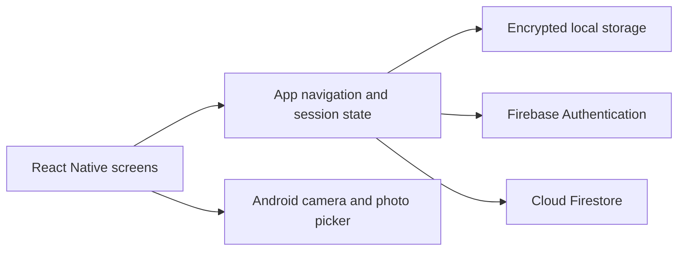

<p align="center">
  
</p>

# Campus4Change

[](https://github.com/Patt-00/Campus4Change/actions/workflows/ci.yml)
[](https://github.com/Patt-00/Campus4Change/releases/latest)

Campus4Change helps students at the Technological Institute of the Philippines find peer tutors, request sessions, join study groups, and message participants.

Students can browse tutors by subject and request a time. Tutors can publish the subjects they teach and their availability. Study groups provide a space for members to share posts and messages.

## Download

Download the signed Android APK from the [Campus4Change v1.4.4 GitHub release](https://github.com/Patt-00/Campus4Change/releases/tag/v1.4.4).

- Direct APK: [Campus4Change 1.4.4](https://github.com/Patt-00/Campus4Change/releases/download/v1.4.4/app-release.apk)
- Package: `com.campus4change`
- Version: 1.4.4, Android version code 12
- Minimum Android version: Android 7.0 (API 24)
- APK SHA-256: `bb18ef8071c3d8932973ff0bb1bd2f950f1aa7b00b352c9882f1936b8c684f92`

The release is a signed APK. It includes the JavaScript bundle and does not need Metro. The app does not include demo accounts or seeded demo content.

## Install the APK

Download the APK from the release link and open it on an Android 7.0 or newer device. If Android asks, allow the browser or file manager to install apps from that source, then confirm installation. Open Campus4Change and sign up with Google or email and password. Complete the TIP profile setup. Email verification is required for shared tutor, session, and group features.

For an update, Android requires the same application ID and signing certificate as the installed copy. Uninstalling a differently signed copy removes local account data and local photos.

## Features

- Firebase email/password and Google sign-in.
- Required profile setup with TIP course, year level, and Quezon City or Manila campus choices.
- A generated Campus4Change UUID for account reference. The UUID does not verify TIP enrollment.
- A copyable account ID on the profile screen.
- Course-grouped learning interests, tutor search, recommendations, and tutor profiles.
- Tutors can set weekly hours for each weekday. Students can request a posted time or suggest a custom time for tutor approval.
- Session requests, tutor acceptance or decline, cancellation, and participant messaging.
- A single session details screen with booking information and completion controls.
- Study-group discovery, shared details, posts, replies, and group chat.
- Animated in-app notifications, separate Settings, and About information.
- An animated startup screen on cold launch that honors the device's reduced-motion setting.
- Built-in avatars and optional profile photos from the system photo picker or camera. Profile photos stay on the device.

## Accounts and data

Firebase Authentication handles online accounts. Cloud Firestore stores private account state and shared tutor, session, and group data. Email-verified accounts can use shared features. The app does not verify school enrollment. The Android release uses Firebase project `campus4change`.

Release builds request Firebase App Check tokens through Play Integrity. As checked on 2026-10-26, the Play Integrity API is enabled, the Android app accepts off-Play installs, and it requires device integrity. Firebase Authentication and Cloud Firestore App Check enforcement remain off; Firestore rules control access. No Cloud Billing account is linked to the Firebase project. These settings live in Firebase and Google Cloud, outside this repository. See the [Firebase App Check Play Integrity guide](https://firebase.google.com/docs/app-check/android/play-integrity-provider). Clearing app data removes local account state and local photos, but it does not delete Firebase accounts or cloud records. A fork must configure its own Firebase project and review `firestore.rules` and `firestore.indexes.json` before deployment.

Tutoring payments, live voice or video calls, operating-system push notifications, and iOS are outside this release's scope.

## Technology

Campus4Change uses React Native CLI 0.87.1, React 19.2.3, JavaScript/JSX, and Hermes. Kotlin Android modules provide encrypted local storage and profile photo capture. Firebase Authentication and Cloud Firestore provide online sign-in and shared data.

## How the app is organized



Screens live in [`src/features/`](src/features/). [`AppNavigator.jsx`](src/navigation/AppNavigator.jsx) connects the screens and shared state. Firebase access is implemented in [`src/shared/backend/`](src/shared/backend/) and feature data modules. The Android project contains the native storage and photo modules.

Firestore rules and indexes are maintained in [`firestore.rules`](firestore.rules) and [`firestore.indexes.json`](firestore.indexes.json). Review them before configuring another Firebase project.

## Build from source

Clone the repository, then run the setup script for your platform. The [build guide](docs/BUILDING.md) lists the supported Node.js, JDK, and Android SDK versions.

```sh
git clone https://github.com/Patt-00/Campus4Change.git
cd Campus4Change
```

From the repository root, run the setup script for your shell:

```sh
./scripts/setup-build.sh --setup
source ./.c4c-build-env.sh
```

On Windows PowerShell:

```powershell
.\scripts\setup-build.ps1 -Setup
. .\.c4c-build-env.ps1
```

Build a debug APK with `./scripts/build-apk.sh --debug` or `./scripts/build-apk.ps1 -Mode Debug`. Build a signed release APK with `./scripts/build-apk.sh --release` or `./scripts/build-apk.ps1 -Mode Release`. Release builds require the existing private v4 keystore and its passwords. The scripts print the APK path and SHA-256 hash after verifying its signature.

Run source checks from the repository root with `npm run lint` and `npm test`.

The [build guide](docs/BUILDING.md) covers Windows, macOS, Linux, and Termux setup and APK builds. The [script guide](scripts/SCRIPT.md) explains script modes, outputs, signing requirements, and troubleshooting.

For a copyable build request and agent workflow, see [AGENTS-BUILDING-GUIDE.md](AGENTS-BUILDING-GUIDE.md).

## Repository layout

- `src/features/` contains the account, profile, tutor, group, session, message, and Settings features.
- `src/shared/` contains shared state, Firebase configuration, theme values, and data helpers.
- `android/` contains the Android project and native Kotlin modules.
- `firestore.rules` and `firestore.indexes.json` define Firestore access and query indexes.
- `docs/BUILDING.md` is the platform build guide.
- `scripts/SCRIPT.md` explains the setup and APK build scripts.
- `AGENTS-BUILDING-GUIDE.md` contains a build prompt and instructions for a coding agent.
